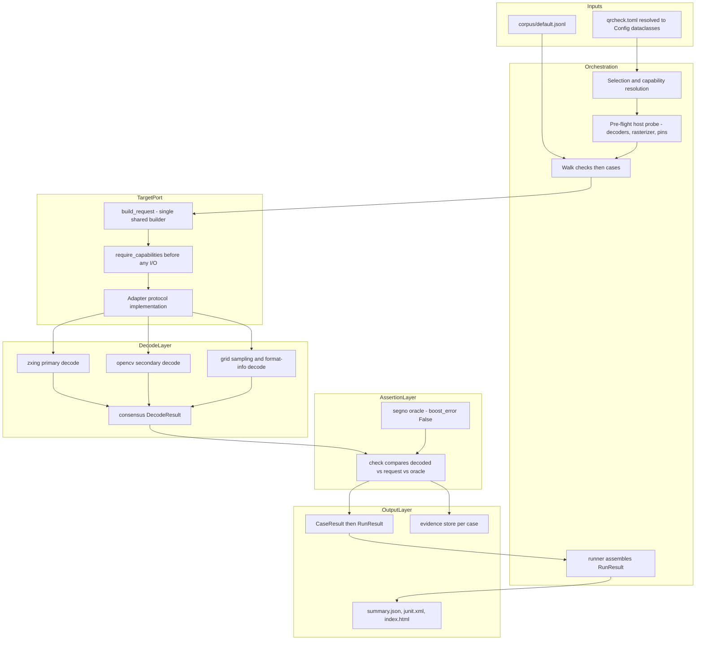

# qrcheck architecture

The structural rationale of `qrcheck`: how the parts are separated, why each seam sits where it does, and which rules hold the separation in place. Read this before changing a component. The per-component contracts it refers to are owned elsewhere — `checks.md` for what each check asserts, `configuration.md` for the configuration contract, `dependencies.md` for the pins and locks, `performance.md` for the budgets, `targets.md` for declaring a target.

## 1. What `qrcheck` is, and what it is not

`qrcheck` is an offline, single-process Python 3.11 command-line framework that tests a QR code **generator**, never a scanner. It drives a generator the configuration declares — through one of three configurable adapter kinds (`library`, `cli`, `http`) or through one of the two built-in self-check targets (`reference`, `defective`) — decodes every symbol that target produces with two independent reference decoders, compares the outcome against a pure-Python golden encoder used only as an oracle, and records payload fidelity, symbol conformance, rendering contract, damage resilience, invalid-input handling, determinism and performance as evidence. Its output is files under `report_dir` — `summary.json`, `junit.xml`, `index.html` and an `evidence/` tree — never a service: there is no server, no daemon, no database, no account and no telemetry, and the only socket the product ever opens is to a loopback HTTP target. Exactly five subcommands exist: `run`, `doctor`, `list`, `corpus` and `loc`. The end-to-end proof of the product's own acceptance criteria is a pytest module, not a sixth subcommand.

## 2. The layered pipeline

The same edges as a walk through the code, in the order a run takes them:

1. `Cfg --> Select` — `qrcheck/config/load.py` parses and validates the configuration into the resolved dataclasses; `qrcheck/registry/selection.py` parses `--checks` and `--class` into the one `Selection` record the run carries.
2. `CorpusFile --> Loop` — `qrcheck/corpus/io.py` reads the committed JSONL corpus; the `--class` globs filter it before any check is walked.
3. `Select --> Probe` — `qrcheck/runner.py` probes what the host provides (both reference decoders and the SVG rasterizer) with **zero** target invocations, and refuses to start when the blocking primary decoder is absent or cannot be imported, or when any other pinned runtime dependency — the oracle or a core library — cannot be imported.
4. `Probe --> Loop` — a passing probe hands the run its resolution: `qrcheck/registry/resolve.py` decides once, before execution, which selected checks are runnable and which are skipped with a reason.
5. `Loop --> Req` — for each case of each runnable check, `qrcheck/checks/support.py` builds that case's request through the port's single builder.
6. `Req --> Cap` — `require_capabilities` refuses a request the adapter did not declare, before any I/O.
7. `Cap --> Adapter` — the adapter resolved through `ADAPTER_TYPES` produces one `GeneratedSymbol`, or raises exactly one of the five adapter errors.
8. `Adapter --> ZX`, `Adapter --> CV` — the artefact bytes reach the primary and the secondary reference decoder.
9. `Adapter --> Geo` — the geometry the grid sampler consumes is the corner quadrangle the primary decoder published on the artefact, or the secondary decoder's rectified image when that quadrangle cannot be snapped to a legal module count.
10. `ZX --> Cons`, `CV --> Cons`, `Geo --> Cons` — `qrcheck/decode/consensus.py` assembles the one `DecodeResult` every check reads: authoritative payload, both EC-level readings, version, mask, matrix digest, per-decoder outcomes, agreement classification and the polarity that produced the answer.
11. `Oracle --> Chk` — `segno` supplies the expected version, the module matrix where the parameters are pinned, and the capacity limits the corpus and the over-capacity probe are built from.
12. `Cons --> Chk` — the check compares the decoded evidence against the request and, where the assertion is oracle-backed, against the oracle.
13. `Chk --> Model`, `Chk --> Ev` — the check returns a `CaseResult` and routes the case's evidence to the single evidence store.
14. `Model --> Run` — the runner accumulates `CaseResult` objects into one `RunResult`, sorted by `(check_id, case_id)`, with counts re-derived from the results.
15. `Run --> Writers` — `qrcheck/report/write_all_reports` serialises that one model into `summary.json`, `junit.xml` and `index.html`.

### The dependency direction, as a rule

Imports point inward only, and the direction is enforced rather than agreed:

| Layer | May import | Must never import |
|-------|------------|-------------------|
| `qrcheck/config/` | the standard library | any other `qrcheck` package |
| `qrcheck/corpus/` | `config`, the standard library | `checks`, `targets`, `decode`, `registry`, `report` |
| `qrcheck/evidence/` | the standard library, and `report.model` inside the two functions that need `failure_id` | `checks`, `targets`, `decode`, `registry` |
| `qrcheck/targets/` | `config`, `corpus.capacity`, `decode.consensus`, and `evidence.mux` deferred inside `reference.py` | `checks`, `registry`, `report` |
| `qrcheck/decode/` | `config.models`, `evidence.mux`, its own submodules; `targets.base` for annotations only under `TYPE_CHECKING` | `checks`, `registry`, `report` |
| `qrcheck/registry/` | `targets.base` (for `Capability`), `report.model` | any concrete adapter, `checks` |
| `qrcheck/report/` | `evidence`, and `registry.check` resolved inside `junit.py` for the family prefix table | `checks` |
| `qrcheck/checks/` | `targets.base` and **nothing else from `targets/`** — not even the `qrcheck.targets` package — plus `decode`, `registry`, `report`, `corpus`, `config`, `evidence` | any concrete adapter |
| `qrcheck/cli/`, `qrcheck/runner.py`, `qrcheck/loc.py` | anything in the package | — |
| anything under `qrcheck/` | — | anything under `tests` |

Three statements in that table are the ones a change most often breaks, so they are stated again as rules:

- **`qrcheck/checks/` sees the port and nothing else of the adapter layer.** `from qrcheck.targets.base import ...` is legal; `import qrcheck.targets`, `from qrcheck.targets import Capability`, and every leaf module (`library`, `cli`, `http`, `reference`, `defective`) are not. That is what makes a fourth adapter kind addable with **no check edit**.
- **Nothing under `qrcheck/targets/` imports `qrcheck.checks`,** in any spelling, including a relative one.
- **`qrcheck/decode/` imports neither `checks` nor `registry` nor `report`,** so the decode layer is exercisable without a target, a registry or a result model.

`tests/unit/test_layering.py` holds all of this by parsing the package's source into an AST rather than searching text, so a comment naming an adapter is not mistaken for an import and a relative `from ..targets.cli import CliAdapter` is resolved before it is judged. It asserts five things: the check-scope rule above; the targets-scope rule; that no module under `qrcheck/` imports anything under `tests`; that the scan cannot pass vacuously — both subtrees must still hold the modules the tree fixes, and a synthetic offender must be flagged by the same collector the assertions use; and that an import hook under `qrcheck/checks/` names its module only by a literal or by a name provably inside `qrcheck.checks`, so `importlib.import_module("qrcheck.targets." + name)`, a variable name, and the hook reached through `getattr` all fail the scan, while the layer's own two dynamic imports — its nine family modules, loaded from a name that can only resolve inside the package, and the literal `"cairosvg"` — stay permitted. It also carries one explicit, sorted allow-list of modules permitted to name a concrete adapter, and it is short: `qrcheck/targets/__init__.py` (the factory table, which resolves class names lazily and so imports none of them), `qrcheck/cli/doctor.py` and `qrcheck/cli/run.py` (which resolve a target through that table), and `qrcheck/targets/defective.py`, the one adapter allowed to reach a sibling because `DefectiveAdapter` reuses the conforming encode path and injects the five declared defects into it. Adding an importer is a deliberate one-line change to that allow-list, never an accidental pass.

Two limitations of a static scan are stated rather than left to be discovered: a module name computed at run time (`importlib.import_module(name)` with a variable) is invisible to it outside `qrcheck/checks/` — inside that layer a computed name is judged and refused unless it is provably inside `qrcheck.checks` — and so is a hook bound to an alias and called through it, which the scan cannot hold without running the code it reads, though a *literal* adapter module name passed to `importlib.import_module`, `__import__` or stored in a table is caught everywhere; and it judges the boundaries named above, not every cycle — `registry` reaching `checks` is the runner's concern, not the scan's.

## 3. Why this shape

Three forces decide the structure, and each is a requirement rather than a preference:

1. **The layering constraint.** Nothing in `qrcheck/checks/` may import a concrete adapter, and a fourth adapter kind must need no change to any check. That forces the target to be a port with implementations behind it, and it puts the seam at `qrcheck/targets/base.py`, the thinnest module in the product: the capability vocabulary, the two records a target exchanges with the framework, the five-error vocabulary, the single request builder, and the capability gate.
2. **Checks must be individually runnable and enumerable.** `--checks` selects a check by exact ID, family glob or `family:` selector, and `qrcheck list` enumerates the same set. A registry of self-describing check contracts gives that; an `if`/`elif` chain over names gives neither selection nor enumeration, and would make "every registered check also appears in a run" untestable.
3. **Three report formats, one model.** JUnit XML for CI, JSON for tooling and a self-contained HTML page for humans are all serialised from one in-memory `RunResult`. That is what makes it impossible for the three artefacts to disagree about a status, and it is why the writers take a `RunResult` and never a check, an adapter or a filesystem walk.

## 4. The component interaction model

`qrcheck/runner.py` owns one run end to end, through the single public entry point `run_suite(config, selection, adapter, ec_level, seed, *, fail_fast=False) -> RunResult`. Its sequence is fixed:

1. capture the run's start time, once;
2. probe what the host provides — both reference decoders and the SVG rasterizer — with zero target invocations, and refuse to start when the blocking primary decoder is absent or cannot be imported, or when any other pinned runtime dependency cannot be imported;
3. resolve the `--checks` selection, because which checks a run selected is what decides what the
   run needs, and load the corpus when that selection reads it — a `--class` filter was given, or a
   selected check draws its cases from the corpus — applying the filter and refusing to start when
   it leaves nothing;
4. build the one `RunContext` the checks of this run share;
5. resolve each selected check's requirements against the adapter's declared capabilities, so every
   check is decided runnable or skipped **before** the first case runs, then remove, before this run
   writes anything, any evidence tree a previous run left under this report root, so that the root
   describes this run alone;
6. walk the runnable checks in check-identifier order and each check's cases in case-identifier order, containing every per-case fault, and finish with the run-scoped checks — the ones whose subject is the whole run — so that they observe the run's end; report order is unaffected, because the results are sorted by `(check_id, case_id)` before the model is built;
7. apply the one-error-result-per-check policy when the target is lost;
8. accumulate one `RunResult` and close the adapter exactly once, whatever happened during the walk.

A check never calls the runner and never knows which check ran before it. It receives a `RunContext` and yields cases; when a case executes and whether it executes at all is the runner's decision alone. The runner is the only place that decides three policies:

- **The pre-flight probe.** A fault found before any case runs — the primary decoder absent or installed but not importable, another pinned runtime dependency (the oracle or a core library) that cannot be imported, the corpus unreadable or malformed when the run's selection reads it, a `--class` filter that leaves zero records — raises `RunPrerequisiteError`, which ends the command with exit code 2 and writes no report.
- **The one-error-per-check policy on target loss.** `TargetUnavailable` and `TargetTimeout` propagate out of a check unchanged, because only this layer can tell one dead target from one defective symbol. On the first such error the check that met it receives exactly **one** `error` result filed under `synthetic:target`, its remaining cases are abandoned, and every later check that requires a capability of the target receives its own single `synthetic:target` error without the target being called again. Checks that declare no capability requirement are target-independent, so they still run and the report describes what was measurable rather than only what broke.
- **Fail-fast.** `--fail-fast` stops launching new checks after the first check that produced a `failed` or `error` result — the run-scoped check still runs, because it never invokes the target and its subject is the finished run; the in-flight check always completes all of its cases, so the report never describes a check whose cases were cut off half-way, and the report stays schema-complete.

What the runner deliberately does not own, because a second owner of each would let two artefacts describe one run differently:

- **Exit codes.** `qrcheck/cli/exit.py` is the only place a code is decided, from the returned model's tallies.
- **Reports.** `qrcheck/cli/run.py` calls `qrcheck/report/write_all_reports` after `run_suite` returns; nothing in the runner serialises a result.
- **Evidence layout.** Each case's evidence is persisted through the single store in `qrcheck/report/evidence.py`; the runner creates that store and hands it to the check layer on the context, and records evidence itself only for the results **it** builds.
- **Adapter-error translation.** `TargetRejected`, `TargetContractError` and `TargetUnsupported` become case outcomes inside the check layer; the runner never repeats that translation and re-implements no capability gate, because `qrcheck/registry/resolve.py` already decided runnability.
- **Retries.** There is no retry, re-run, quarantine or `xfail` path anywhere in the product (section 14).

`run_suite` raises none of the five adapter errors itself — that vocabulary belongs to `qrcheck/targets/` — and produces exactly four kinds of outcome: a `RunPrerequisiteError`, an `error` result, a `skipped` result built by `qrcheck/registry/resolve.py`, or a `passed`/`failed` result accumulated verbatim from a check.

## 5. The adapter port

`Adapter` in `qrcheck/targets/base.py` is a `runtime_checkable` `Protocol` with exactly four members, and no fifth, so a stub in a test implements it in four lines and a real adapter has nowhere to hide:

| Member | Type | Contract |
|--------|------|----------|
| `name` | `str` | The configured target name, which every diagnostic quotes |
| `capabilities` | `frozenset[Capability]` | What this adapter declares it can do; compared and differenced against a check's requirements |
| `generate` | `(request: GenerateRequest) -> GeneratedSymbol` | Produce one symbol, or raise exactly one of the five adapter errors |
| `close` | `() -> None` | Release what the adapter holds, and be safe to call twice — the runner closes every adapter once, including after a failure |

Protocol conformance is asserted with `isinstance(adapter, Adapter)` and never with `issubclass`: on CPython 3.11 a runtime-checkable protocol with non-method members (`name` and `capabilities` here) supports `isinstance` by attribute presence, while `issubclass` raises `TypeError`.

### The capability vocabulary

`Capability` is a `StrEnum` closed at **thirteen** members, declared in this fixed order: `png`, `svg`, `ec_level`, `module_size`, `quiet_zone`, `color`, `logo_overlay`, `version_pin`, `mask_pin`, `metadata_version`, `metadata_ec`, `metadata_mask`, `metadata_mode`. Because a member *is* its string value, `Capability.png == "png"` holds and a set of members compares and hashes equal to the `frozenset[str]` a resolved configuration carries — which is what lets capability intersection work across the configuration seam without either side importing the other. No check, adapter or resolution rule may add, rename, reorder or omit a member; which checks require which of them is `checks.md`'s table, not this document's.

The names are declared twice by necessity — `CAPABILITY_NAMES` in `qrcheck/config/models.py`, which may not import this package, and `Capability` in `qrcheck/targets/base.py` — and the two declarations are gated against each other at import of the port, so a rename on either side fails loudly instead of leaving the configuration schema accepting a capability no adapter can express.

### The two records

`GenerateRequest` is the request contract in full: ten fields, no `__post_init__`, no coercion, no guard.

| Field | Type | Default |
|-------|------|---------|
| `payload` | `bytes` | required |
| `ec_level` | `Literal["L", "M", "Q", "H"]` | `"M"` |
| `output_format` | `Literal["png", "svg"]` | `"png"` |
| `module_size_px` | `int \| None` | `None` |
| `quiet_zone_modules` | `int \| None` | `None` |
| `foreground_rgb` | `tuple[int, int, int]` | `(0, 0, 0)` |
| `background_rgb` | `tuple[int, int, int]` | `(255, 255, 255)` |
| `logo_overlay_path` | `Path \| None` | `None` |
| `version` | `int \| None` | `None` |
| `mask` | `int \| None` | `None` |

`payload` is bytes and never text, so byte-exactness is unambiguous: a payload that is not valid UTF-8 still round-trips, and nothing guesses an encoding on the caller's behalf. The eight fields after `payload` carry defaults for convenience only; a check that needs a specific geometry, colour or pin always passes it explicitly.

**`GenerateRequest` validates nothing.** That is a contract, not an oversight. `IV-EMPTY`, `IV-OVERCAPACITY` and the four `IV-BAD-OPTION` probes exist to prove a target rejects requests that break exactly the rules the framework's builder enforces, so they must be able to hand a target a deliberately illegal request (`ec_level="X"`, `module_size_px=0`, `quiet_zone_modules=-1`, a colour pair below the declared floor). They do so through `construct_out_of_contract` in `qrcheck/checks/support.py`, a plain constructor call that marks the case `out_of_contract: true` in `request.json` so no reader mistakes it for a legal request. Validation added to the type would silently make every `IV-*` case unconstructable.

**`build_request` is the single gate.** Every ordinary case builds its request through it, so the product has one definition of "the framework considers this request valid": an error level outside `L`/`M`/`Q`/`H`, a version outside 1..40, a mask outside 0..7, a non-positive module size, a negative quiet zone, a colour channel outside 0..255, a non-bytes payload, or a payload that does not fit the requested version and error level per the capacity tables in the payload's own mode is refused there, before any target sees it. It raises `ValueError` naming the offending field — deliberately not `TargetRejected`, which would report a framework bug as a target defect — and the runner converts that into an `error` result carrying its traceback.

`GeneratedSymbol` is the artefact plus the metadata the target claims about it.

| Field | Type | Meaning |
|-------|------|---------|
| `image_bytes` | `bytes` | The artefact exactly as the target produced it |
| `output_format` | `Literal["png", "svg"]` | The format actually produced; a mismatch with the request is a contract failure |
| `declared_version` | `int \| None` | The target's own claim — evidence only |
| `declared_ec` | `str \| None` | The target's own claim — evidence only |
| `declared_mask` | `int \| None` | The target's own claim — evidence only |
| `declared_mode` | `str \| None` | The target's own claim — evidence only |
| `elapsed_ms` | `float` | Target-side timing: recorded, reported, excluded from every determinism comparison |

The four `declared_*` fields are **evidence only, never the assertion**. `SY-EC-MATCH` reads the EC level from the primary decoder and from the symbol's own format information, `SY-MASK` reads the mask from the format information, and `SY-VERSION-MIN` takes the version from the sampled module count, so a target that lies about its metadata is recorded as having lied rather than believed.

### The capability gate

`require_capabilities(adapter, needed)` raises `TargetUnsupported` **before any I/O** when the adapter does not declare every needed capability. It only reads `adapter.capabilities`, returns immediately for an empty requirement, has no side effect and names the missing capabilities in sorted order so its message is identical on every run. An unsupported request therefore never reaches a target and never consumes its `timeout_s`. It has two callers, answering two different questions, and neither replaces the other: `qrcheck/registry/resolve.py` uses it to turn a shortfall into a `skipped` result *before* execution, and an adapter uses it as its own guard for a request that reaches it by any other route.

### The five implementations, and the one extension point

| `type` | Class | Module | Kind |
|--------|-------|--------|------|
| `library` | `LibraryAdapter` | `qrcheck/targets/library.py` | in-process import and call, with `kwargs_map` and `returns` decoding |
| `cli` | `CliAdapter` | `qrcheck/targets/cli.py` | argv-only subprocess with `timeout_s` |
| `http` | `HttpAdapter` | `qrcheck/targets/http.py` | loopback HTTP, request shape entirely from configuration |
| `reference` | `ReferenceAdapter` | `qrcheck/targets/reference.py` | conforming segno-backed self-check target, declaring all thirteen capabilities |
| `defective` | `DefectiveAdapter` | `qrcheck/targets/defective.py` | the five injections of the non-vacuity proof, built on the conforming encode path |

`ADAPTER_TYPES` in `qrcheck/targets/__init__.py` maps each `type` value to its class and is the single extension point: `ADAPTER_TYPES[target.type](target, name=target_name)` is the only way an adapter is ever built. Each row records a module name and a class name rather than the class, and the row is imported when its `type` is resolved, so `import qrcheck.targets` imports no adapter at all — a process that only asks the registry which checks exist never pays for `segno`, `httpx` or `click`. Enumeration, length, membership and `repr` import nothing; a lookup of an undeclared key raises `KeyError` having imported nothing. The table is a read-only `Mapping`, because it is configuration vocabulary rather than run state and a caller able to mutate it could redirect a whole run.

Adding a target kind is four steps and no fifth: create `qrcheck/targets/<kind>.py` implementing the port and raising only the five errors; add one entry to `ADAPTER_TYPES`; add the `type` value to the configuration's adapter-type vocabulary; add the kind's per-type keys to the configuration schema (`targets.md` covers the last two from a target author's side). **No check module changes** — that is the property the extension point exists to preserve, and `tests/unit/test_adapter_types.py` asserts that `ADAPTER_TYPES` covers every value of the `type` enum and that each factory returns an object satisfying the protocol.

## 6. Error taxonomy

Exactly five adapter errors exist, all subclasses of `TargetError`. Each has exactly one trigger, and an adapter raises nothing else.

| Error | Exact trigger | What the consumer reports |
|-------|---------------|---------------------------|
| `TargetUnavailable` | Process cannot be spawned, connection refused, import path missing. | An `error` result naming the transport failure, `case_id` `synthetic:target`, **one per affected check** — not one per corpus record — and the run continues to the checks that do not need the target. |
| `TargetTimeout` | No response within `targets.<name>.timeout_s`. | An `error` result naming the configured timeout in seconds and the operation attempted, so a reader can tell a slow target from a hung one. |
| `TargetRejected` | Target returned a declared client-side rejection for a request the framework considers valid; the check reports the rejection text verbatim. | A `pass` for the `IV-*` checks, which record the text in `decoded.rejection`; a failure with reason `target_rejected` and the text unchanged everywhere else. |
| `TargetContractError` | Response present but unusable: empty body, undecodable base64, image bytes that no decoder or image library can open, missing field named in config. | A `failed` result; when there are body bytes to keep, the first 256 bytes are recorded as their 512-character hex form. |
| `TargetUnsupported` | Request asks for a capability the adapter did not declare; raised before any I/O. | A `skipped` result with reason `unsupported_capability`, counted separately and never as a pass. Normally pre-resolved by `qrcheck/registry/resolve.py` before execution; this error is the belt-and-braces path. |

`TargetRejected` carries the target's text unchanged: `str(exc)` is exactly what the target said, never re-wrapped, prefixed, truncated or reformatted, because the `IV-*` checks record it verbatim in `decoded.rejection`.

### Conversions at the boundary

Every `except` inside `qrcheck/targets/` converts a library exception into one of the five rather than re-raising it raw. The list is exhaustive:

- **segno** — `DataOverflowError` → `TargetRejected`, with the capacity and the requested length in the message; `ValueError` → `TargetRejected` carrying segno's own text, the pinned release's only other complaint and its wording for an illegal level, version or mask; anything else → `TargetContractError`. The pinned segno 1.6.6 defines exactly one dedicated exception, `DataOverflowError`, and has no `VersionError`, `ErrorLevelError`, `ModeError` or `MaskError` — segno's own documentation still names the first two of those, but nothing at that version defines any of them — and where a release does define them they are `ValueError` subclasses, so the `ValueError` clause above already converts them. Both built-in targets validate the request before calling segno precisely so this mapping stays predictable.
- **httpx** — `TimeoutException` → `TargetTimeout`; `ConnectError`, `ConnectTimeout` and `UnsupportedProtocol` → `TargetUnavailable`; a non-2xx status or an undecodable body → `TargetContractError`.
- **subprocess** — `TimeoutExpired` → `TargetTimeout`; `FileNotFoundError` and `PermissionError` on spawn → `TargetUnavailable`; a non-zero exit whose output parses as a declared rejection → `TargetRejected`, otherwise `TargetContractError`.
- **library adapter** — `ImportError` or `AttributeError` while resolving the callable → `TargetUnavailable`.
- **image handling** — `PIL.UnidentifiedImageError`, `binascii.Error` and an empty body → `TargetContractError`.

### The closure rule

Every `except` in `qrcheck/targets/` re-raises one of the five. An exception type that reaches the runner instead is a **framework defect, not a target defect**: it becomes an `error` result carrying its traceback (normalised so no absolute frame path is published), the run continues, and the process exits 3 at the end. That is what stops one broken check from destroying the attribution of an otherwise complete run.

## 7. The decode pipeline

Two independent reference decoders, one authority. `zxing-cpp` 2.2.0 is the **primary** decoder and its payload is authoritative for **every one** of the twenty-one checks, not only for `RT-ROUNDTRIP`: every check compares against `DecodeResult.payload_bytes`, which is the primary decoder's payload whenever it produced one. `opencv-python-headless` 4.10 is the **secondary** decoder — corroboration, a second opinion, and the fallback geometry source — and it never rescues a symbol the primary decoder could not read. The shapes all three consumers speak (`DecoderOutcome`, `ModuleCountEstimate`, `SampledMatrix`, `DecodeResult`) are declared once in `qrcheck/decode/base.py`; `qrcheck/decode/__init__.py` is the facade — its `decode_symbol` delegates to the consensus pipeline and defines no decoding step of its own — and the availability reporter. Neither decoder binding is imported at module scope, so `import qrcheck.decode` carries no native image stack and a host where the primary decoder is absent can still be diagnosed.

### Why the framework recovers the version and the mask itself

The pinned `zxing-cpp` 2.2.0 surface reports `ec_level` but **no version and no mask** — both arrive only in 3.x — and OpenCV 4.10 reports none of the three. Yet `SY-VERSION-MIN`, `SY-EC-MATCH`, `SY-MASK`, `SY-MATRIX-EQUIV` and the measured quiet zone all need the module grid and the symbol's own metadata. So the grid is recovered from the symbol itself, and the version is read off the grid's dimension.

### Grid sampling

ISO/IEC 18004 §7.1 fixes a Model 2 symbol's dimension at **N = 4V+17** modules per side for Version 1–40 — 21 modules for Version 1, 177 for Version 40 — and `version_from_dimension` in `qrcheck/decode/matrix.py` inverts that rule. It is the product's **only** version source: nothing else may derive a version from a decoder, a target's metadata or a capacity table.

Three acceptance paths exist, and nothing else:

1. **Primary.** The primary decoder's corner quadrangle in source-image pixels is projected onto an `N x N` grid by a planar homography; the module pitch is measured from the symbol's top-left finder pattern; the module count is snapped to a legal `4V+17`; and the snap is confirmed against the timing patterns. The estimate is `N_est = round(S / p)` for a rectified square of side `S` and a measured pitch `p = w / 7`, where `w` is the dark run across the finder pattern's middle row — exactly seven modules wide per ISO/IEC 18004 §7.3.3.
2. **Fallback.** When the primary path fails and the secondary decoder supplied its rectified `straight_qrcode` image, the same pitch/snap/confirm procedure runs on that image, which needs no homography because the decoder has already rectified it. The result is labelled `source="straight_qrcode"`.
3. **Failure.** When both fail, `SampledMatrix` carries `matrix=None` with `reason="sampling_failed"`, and the four matrix-dependent checks plus the measured quiet zone report `failed` with that reason rather than a wrong verdict. The estimate, the rectified luminance where the caller asked for it, and the timing-pattern counts go to evidence, so "the grid could not be recovered" is diagnosable.

Neither guard may be relaxed, because a shifted grid produces a *wrong verdict* in `SY-MASK`, `SY-EC-MATCH`, `SY-MATRIX-EQUIV`, `SY-VERSION-MIN` and the measured quiet zone. A pitch that is off is therefore rejected twice over: the implied pitch of the snapped count must lie within 20 % of the measured pitch, and the sampled timing patterns must show exactly `N - 16` alternating transitions on both axes. A quadrangle that overshoots the symbol is refused rather than re-anchored from the rectified image's dark extent, because silently recovering it would turn a wrong measurement into a confident one.

The sampled region is the symbol's own area, **excluding** the quiet zone (ISO/IEC 18004 §7.3.6): a corner quadrangle bounds the symbol, not its quiet zone, so quiet-zone measurement is the owning check's business, done from the returned grid's dark bounding box. The consequence of that split is the failure path above: a check that needs the measured quiet zone fails with `sampling_failed` rather than with a wrong measurement when no grid can be recovered.

Every refusal on target-derived data is a **value, never an exception**: `accepted=False` on `ModuleCountEstimate` with one of the reasons `position_unusable`, `low_contrast`, `finder_unreadable`, `pitch_mismatch`, `timing_mismatch` or `fallback_unusable`. Only an array that violates the sampler's own input contract raises `ValueError`, because that is a producer defect rather than evidence about a target.

### Format information

`qrcheck/decode/format_info.py` is the single source of the **mask** and the independent second source of the **error correction level**, and it reads both out of the sampled grid without consulting a decoder:

- both copies of the 15-bit format information are read from the module positions ISO/IEC 18004 §7.9.1 fixes, including the two module positions the timing patterns occupy and the fixed dark module that belongs to neither copy;
- the 15 bits are XOR-masked with `0x5412` before decoding, so a symbol whose format modules are all light can never present itself as the all-zero, valid-looking codeword;
- the five data bits are protected by ten BCH(15, 5) parity bits from generator `0x537`; its code has minimum Hamming distance 7, so up to three bit errors are corrected per copy and no two candidates can ever tie;
- the two-bit EC indicator reads `L=01`, `M=00`, `Q=11`, `H=10` (ISO/IEC 18004 Table 12), and the three-bit mask reference comes from the same field;
- the 32 valid bit sequences are generated from the BCH routine rather than transcribed, so the only hand-written values are the generator polynomial and the XOR mask.

An unreadable grid, an unreadable copy and a copy corrupted beyond three bits all come back as `None`. The consensus layer records that as absent format information, and the checks report it as `sampling_failed`. Nothing here raises for bad symbol data: an exception escaping this module would turn a defective symbol into an `error` result and destroy the run-level attribution the self-check targets depend on.

## 8. The consensus rules, as contract

`qrcheck/decode/consensus.py` assembles the one `DecodeResult` every check reads. Each rule below is contract, not implementation detail.

1. **A decoder that returns no payload is `undetected`, never a disagreement.** `disagree` requires two payloads that differ, so a decoder's silence can never fail a conforming target. An empty payload the decoder genuinely read is a different fact from a missing payload, and the invalid-input checks depend on that distinction.
2. **One authority for all twenty-one checks, with no exception.** `payload_bytes` is the primary decoder's payload whenever it produced one, for every check and not only for `RT-ROUNDTRIP`. The secondary decoder never becomes the authority and never overwrites what the primary reported. The one refinement in how the two answers are compared is the text-versus-bytes rule stated after these nine; the one check-side concession is rule 8's.
3. **`primary_only` proceeds on primary evidence.** When the primary succeeds and the secondary does not, the check continues on the primary's evidence and the secondary's outcome is recorded in `decoded.json`. That is also the shape of single-decoder mode, where the secondary decoder is simply not installed.
4. **`secondary_only` fails the check.** When the primary fails and the secondary succeeds, the check fails, because the symbol did not decode under the authority; `payload_bytes` stays `None`, and the secondary payload is recorded as corroboration or contradiction. No check can pass on the secondary's strength.
5. **`decoder_disagreement` requires two payloads that differ.** When both decoders succeed with different payloads the check fails with reason `decoder_disagreement`, the framework does not pick a winner, and the evidence holds both payloads and both metadata blocks verbatim.
6. **Two EC-level readings are never reconciled.** `ec_level_decoder` is the primary decoder's metadata and `ec_level_format` is the symbol's own 15-bit format information. A disagreement between them is the `format_info_disagreement` finding a check reports, with both values recorded; collapsing one into the other here would delete the finding.
7. **Inversion is handled by the framework, not hoped for from a decoder.** `zxing-cpp` 2.2.0 exposes no inversion switch, and OpenCV 4.10 cannot detect a light-on-dark symbol at all. So an inverted request — one whose `foreground_rgb` is lighter than its `background_rgb` — is decoded twice, with **both** decoders run on the artefact as generated and again on its 255-inverted copy. The first polarity at which the primary decoder yields a payload is authoritative; `polarity_applied` records `original` or `inverted` for the authoritative payload, and each decoder's own outcome records the polarity it came from, which is `both` only when it returned the same payload at each. The grid is sampled from the normalised copy, because sampling a light-on-dark array measures the finder pattern's light ring as its dark run and reports `finder_unreadable`. Every non-inverted request is decoded once, in the polarity as generated; the second pass exists only so that `RN-CONTRAST`'s inverted case does not depend on a feature the pinned decoders do not have.
8. **Under `DM-*` damage only the primary decoder's success is asserted,** and the secondary's outcome is recorded. Rules 1 and 3 already guarantee that a secondary decoder's silence at a narrow quiet zone or under blur cannot manufacture a failure, so damage needs no special case in this layer.
9. **The damage budget and the logo decode assertion are derived from the EC level decoded from the symbol,** not from the requested level. A target that encodes below the requested level therefore cannot push damage past that symbol's real recovery capacity, which is what keeps the expected failing set of the `defective` target exactly enumerable. `checks.md` owns the per-check consequences of that rule.

One refinement the implementation makes over the plan, recorded here so it is not read as an oversight: the secondary decoder returns **text**, so for a payload that is not losslessly text-representable — the binary corpus classes, every base64 record — its re-encoded bytes legitimately differ from a binary primary payload even on a perfectly conforming symbol. `disagree` therefore applies only when the primary payload round-trips through UTF-8 and the secondary's payload still differs; anything else the secondary cannot corroborate is recorded as `primary_only`. This never loosens the primary's authority — it only declines to let a corroborator that cannot speak about bytes contradict bytes, which is what keeps forty conforming binary records from failing the clean-run gate.

The refinement is a narrowing of rule 5, so it is recorded rather than inferred, and `DecodeResult.secondary_comparable` is the only place it is visible. The rule as the plan states it is unconditional: two payloads that differ are `decoder_disagreement` and nothing else. The pinned secondary decoder cannot meet it — `opencv-python-headless` 4.10's `QRCodeDetector` answers in text only, so for a binary payload its re-encoded answer differs from the primary's bytes on a conforming symbol — and the clean-run gate demands a completely clean conforming run, so applying the rule literally would fail all forty `random-bytes` records and leave the suite's non-vacuity proof with no clean run to compare against. Both requirements cannot hold at once, and the resolution is to keep the conforming run green while making the departure a recorded fact:

| `secondary_comparable` | Meaning |
|------------------------|---------|
| `true` | Both decoders answered and their payloads were comparable — they are equal, or the primary's payload round-trips through UTF-8, so the secondary's text could have contradicted it. |
| `false` | Both decoders answered with differing payloads that cannot be compared: the primary's payload does not round-trip through UTF-8, so the text-only secondary decoder's answer cannot be held against it. This is the refinement's case, and the `disagree` decision is declined here and only here. |
| `null` | No comparison was attempted: the secondary decoder did not run, found nothing or errored, or the primary decoder produced no payload. |

The classification and this field are derived once, in the consensus layer, so they cannot disagree: a `primary_only` with `secondary_comparable: false` is an uncorroboratable answer, while the same `primary_only` with `null` is a secondary decoder that said nothing. `decoded.json` and `summary.json` therefore separate the two without a reader having to infer the case from a decoder's status.

## 9. The oracle, and what must never be asserted

`segno` 1.6.6 is the authoritative expectation source. It decides the minimal version that fits a payload at a requested EC level, the module matrix where the parameters are pinned, the per-mode version that proves mode optimality, and the capacity limits the corpus and the over-capacity probe are built from. It is used strictly as an oracle: nothing it produces is ever compared with itself at parameters the product has not pinned.

### Two segno defaults would silently corrupt every expectation

Both are disabled at every call site — the oracle, the `reference` target and the `defective` target alike — and both call for a reason.

- **`boost_error=False`.** segno's default is `True`, which spends spare capacity on a higher EC level **without** changing the version. An oracle built at defaults would therefore expect a different EC level than the target was asked for, and every oracle-backed assertion would fail a conforming target for a property the request never made.
- **`micro=False`, by calling `segno.make_qr` and never bare `segno.make`.** `segno.make()` returns a **Micro QR** symbol whenever the payload fits — `segno.make("")` yields an M3 symbol — and a Micro symbol has no `4V+17` module count, no Version 1–40 number and a different format-information layout. `N = 4V+17`, `version_from_dimension`, the mask and EC extraction and every capacity lookup would therefore be wrong on exactly the short payloads the corpus is full of. Micro QR and Structured Append are out of scope, so the embedded capacity tables carry Versions 1–40 only and the absence of the Micro rows is asserted rather than assumed.

### What must never be asserted, and the substitute for each

| Wrong assertion | Why it is wrong | Substitute |
|-----------------|-----------------|------------|
| Two encoders produce the same module matrix for a payload at an unpinned version, EC level and mask. | Mask selection is encoder-defined, and the request says so explicitly. | Matrix equality only at a pinned version, EC level and mask (`SY-MATRIX-EQUIV`); for unpinned cases, version and EC level are asserted against the oracle and the mask only as a value in 0–7. |
| The mask equals a specific number for an unpinned request. | The mask is a property of the encoder's penalty scoring, not of the payload. | `SY-MASK` asserts a value in 0..7 for an unpinned request, and equality only when a mask is pinned. |
| The target must reject anything the framework dislikes. | A declared rejection is only one of two acceptable outcomes for an empty payload. | `IV-EMPTY` records "declared rejection **or** documented success, never a crash, never a partially written file". |
| A logo overlay at EC level L must fail to decode. | The framework records which outcome occurred rather than asserting success at a level whose recovery capacity cannot cover the overlay. | `RN-LOGO` asserts the EC-H case decodes and records the EC-L outcome. |
| Latency is a specific number. | Timing is environment-bound. | Only `PF-ENCODE` and `PF-DECODE` assert a configured ceiling; every other check records its duration and asserts nothing about it (`performance.md` owns the budgets). |
| The SVG's byte layout is standard. | SVG authoring is encoder-defined. | `RN-SVG` asserts that the artefact parses, carries the module count the version implies, and rasterizes to a decodable symbol. |

### One documented limitation, so no reader mistakes it for independence

The `reference` target is built on segno, so `SY-MATRIX-EQUIV` against `reference` compares the oracle with itself in the encoder dimension. What that check still proves is the render, sample and decode path end to end, and the tautology is broken by the `defective` target, whose matrix differs from the oracle's at pinned parameters. The genuinely independent evidence is the decoder-derived set — `RT-ROUNDTRIP` and `MD-CHARSET` from the primary decoder's payload, `SY-EC-MATCH`'s decoder-side reading, `SY-MASK` from the format information — together with decoder-versus-decoder agreement. No second encoder is added: the dependency set is fixed and names one oracle.

### What the product owes a user when a tool is absent

| Absent | Behaviour | Where the user sees it |
|--------|-----------|------------------------|
| `zxing-cpp`, the primary decoder | **Refuse.** `qrcheck doctor` and `qrcheck run` both exit 2 naming the dependency and the interpreter/platform; `RT-ROUNDTRIP` is never silently skipped. The same refusal covers a binding that is installed yet cannot be imported, because both commands confirm the load through the shared importability probe instead of trusting module presence. On a platform with no 2.2.0 wheel the diagnostic additionally names the platform tag and says no wheel is published for it. | stderr diagnostic; no report written |
| `segno`, the oracle | **Refuse.** `qrcheck doctor` reports it as a blocking core distribution and exits 2 naming it, and no run can make an oracle-backed assertion without it. It is a required runtime dependency, so an absent or unimportable install is a broken environment rather than a user choice. | stderr diagnostic; no report written |
| The secondary decoder | **Degrade.** The run proceeds in single-decoder mode; `qrcheck/decode/consensus.py` records `agreement == "primary_only"`, and `index.html` carries a banner stating how many decode-bearing cases the corroborating decoder did not answer for, naming it as either not installed or asked and unable to read the artefact. When the decoder is not installed, `decoded.json`'s `per_decoder` holds the primary decoder alone; when it is installed but cannot be imported or run, `per_decoder` holds both names, the secondary at status `error` with its diagnostic in `error_text`, and no comparison was attempted, so `secondary_comparable` is `null`. No check is marked passed on the strength of a decoder that did not answer. | `decoded.json`, the HTML banner, and the run's own results |
| An SVG rasterizer | **Degrade.** `RN-SVG` reports `skipped` with reason `missing_dependency`, and the result records the discovery order the framework attempted; a skip is counted separately and never as a pass. | the skipped block in `index.html`, and the reason in `summary.json` |

The rasterizer discovery itself has one owner, `qrcheck/checks/render.py`, and one order: an importable `cairosvg` first, then `rsvg-convert`, `resvg`, `magick` and `convert` on `PATH`. The order is a contract rather than a preference, because a report quotes the sequence it attempted, so reordering it changes a report. The discovery is imported **into** `qrcheck/runner.py` and `qrcheck/cli/doctor.py`, never re-implemented there. `dependencies.md` owns what each of those tools is and which platforms provide it.

## 10. Module map and single owners

| Location | Files | Responsibility |
|----------|-------|----------------|
| root | `qrcheck/__init__.py`, `qrcheck/__main__.py` | package surface, version, and the `python -m qrcheck` entry point |
| root | `qrcheck/runner.py` | orchestration of exactly one sequential run: probe, resolve, walk, fail-fast, target-loss policy, accumulate, close |
| root | `qrcheck/loc.py` | the one definition of a tracked physical line, comments and blanks included |
| `qrcheck/cli/` | `main.py`, `run.py`, `doctor.py`, `list.py`, `corpus.py`, `loc.py`, `exit.py` | the click group and the five subcommands, plus the only exit-code mapping |
| `qrcheck/config/` | `schema.py`, `load.py`, `models.py`, `seeding.py` | the configuration contract, TOML loading with path resolution, the resolved dataclasses, the single seed derivation point |
| `qrcheck/targets/` | `base.py`, `library.py`, `cli.py`, `http.py`, `reference.py`, `defective.py`, `__init__.py` | the adapter port, its five implementations and the factory table |
| `qrcheck/decode/` | `base.py`, `zxing.py`, `opencv.py`, `consensus.py`, `matrix.py`, `format_info.py`, `__init__.py` | the two decoder wrappers, the consensus classification, grid sampling and format information, plus the facade and availability probes |
| `qrcheck/corpus/` | `capacity.py`, `payloads.py`, `builder.py`, `io.py`, `__init__.py` | capacity tables, one seeded generator per payload class, the corpus builder, canonical JSONL read and write |
| `qrcheck/checks/` | `support.py`, `roundtrip.py`, `symbol.py`, `mode.py`, `render.py`, `damage.py`, `invalid.py`, `determinism.py`, `performance.py`, `cleanup.py`, `__init__.py` | the twenty-one checks, one module per family, plus the shared case and request support and the explicit `FAMILY_MODULES` tuple that imports them |
| `qrcheck/registry/` | `check.py`, `selection.py`, `resolve.py`, `expectations.py`, `__init__.py` | check identity, selection parsing, capability and dependency resolution, expected failing sets |
| `qrcheck/report/` | `model.py`, `junit.py`, `json_report.py`, `html.py`, `evidence.py`, `__init__.py` | the result model, the three writers, the evidence store and the `write_all_reports` dispatch |
| `qrcheck/evidence/` | `naming.py`, `mux.py`, `__init__.py` | the evidence layout constants and sanitization, and the image byte path (encode, decode, data URI, `open_image`) |

Each cross-cutting concern has exactly one owner, and **a second implementation of any of them is a defect**, not a style preference:

| Concern | Owner |
|---------|-------|
| Check registration, identity and ordering | `qrcheck/registry/check.py` |
| Selection parsing and the empty-selection diagnostic | `qrcheck/registry/selection.py` |
| Capability and dependency resolution to skip reasons | `qrcheck/registry/resolve.py` |
| Expected failing sets for the self-check targets | `qrcheck/registry/expectations.py` |
| Result model, statuses, reasons and failure IDs | `qrcheck/report/model.py` |
| Evidence persistence policy | `qrcheck/report/evidence.py` |
| Evidence naming, layout and sanitization | `qrcheck/evidence/naming.py` |
| Configuration schema, defaults and validation | `qrcheck/config/schema.py` with `qrcheck/config/models.py` |
| Seed derivation | `qrcheck/config/seeding.py` |
| The line-count metric | `qrcheck/loc.py` |
| Request construction and the capability gate | `qrcheck/targets/base.py` |
| Report serialization | `qrcheck/report/junit.py`, `qrcheck/report/json_report.py`, `qrcheck/report/html.py` |
| Exit-code decisions | `qrcheck/cli/exit.py` |
| SVG rasterizer discovery and rasterization | `qrcheck/checks/render.py`, imported into the CLI and never the reverse |

Three consequences of that table are worth naming, because they are the ones a change tends to duplicate:

- **`failure_id()` in `qrcheck/report/model.py` is the only definition of a failure ID.** Its shape is `<CHECK-ID>__<case_id>__<reason>`, every character outside `[A-Za-z0-9._-]` replaced by `_`, and the whole identifier bounded at 64 characters: when the sanitized form is longer, its first 55 characters are kept and an underscore plus an 8-hex `sha256` digest is appended, so the bound applies to the complete path segment rather than to its prefix. `qrcheck/evidence/naming.py` calls it rather than re-deriving it, which is why the identifier inside an evidence path cannot disagree with the identifier `summary.json` records for the same case.
- **`qrcheck/registry/check.py` holds the only literal list of the twenty-one check identifiers** and the nine family names with the prefix each owns. A check registers itself through the decorator at import of its family module; `FAMILY_MODULES` in `qrcheck/checks/__init__.py` is the explicit, ordered tuple of those nine modules, so which checks exist never depends on whether some unrelated module happened to import a family.
- **Thresholds are declared once, in `qrcheck.toml`,** with the fallback for an omitted key declared once as a `models.DEFAULT_*` constant. A check or test reads a declared threshold from its key rather than from a numeric literal of its own, and no document restates one as an authority: each document that quotes a declared default for its reader names the configuration key that owns it, and the quotation carries no authority, so a volume, budget or fraction cannot disagree with itself across the product. `configuration.md` owns the keys and their defaults; `performance.md` owns the budgets defined on them.

## 11. Determinism, structurally

Determinism is an architectural property here, not a test habit: a run must be reproducible from the values its report records, on any machine, in any process, in any order the interpreter happens to schedule things.

### The single seed derivation point

`derive_seed(run_seed, *parts)` in `qrcheck/config/seeding.py` is the only seed-derivation function in the product, and every seeded draw the product makes goes through it: corpus payload generation, occluder placement and size, additive-noise patterns and the logo overlay bitmap. Its semantics are exact and total:

- the run seed and every part are stringified and joined with a literal `"|"`;
- the joined text is encoded as UTF-8 and hashed with SHA-256;
- the first 8 bytes of the digest, read big-endian, are the derived seed — an unsigned 64-bit integer, the range `numpy`'s `PCG64` consumes directly;
- integer parts are stringified **inside** the function, so `derive_seed(1, 2)` and `derive_seed(1, "2")` are the same seed and a call site may pass a corpus record index as an `int`.

The only consumer is `numpy.random.Generator(numpy.random.PCG64(seed))`, whose bit stream is stable across numpy releases. The value comes from SHA-256 alone — never from `PYTHONHASHSEED`, a locale, a timezone or filesystem order. The declared callers and the part convention each owns are `qrcheck/corpus/payloads.py` with `derive_seed(seed, class_name, record_index)`, `qrcheck/checks/damage.py` with `derive_seed(seed, "DM-RESILIENCE", case_id, kind)`, and `qrcheck/checks/render.py` with `derive_seed(seed, "RN-LOGO", case_id, "logo")`. A new call site adds a convention here rather than inventing a second derivation.

One deliberate limitation, which must not be "fixed": nothing is escaped, so `derive_seed(1, "a", "b")` and `derive_seed(1, "a|b")` are the same seed. Callers pass identifiers that cannot contain `"|"` — check IDs, case IDs (`corpus:<record-id>`, `synthetic:<name>`), class names, damage-kind tokens — and adding escaping would change every derived seed in the product and, with them, every committed damaged-image filename.

Because of this one point, a run is reproducible from what the report records alone: the run `seed`, the `adapter`, the `ec_level`, and per result the case-level `seed`. Any single damaged image can be regenerated from the run seed, the check ID, the case ID and the damage kind without re-running anything else — which is exactly what `DM-SEEDED` asserts.

### Ordering rules

| Collection | Order | Enforced by |
|------------|-------|-------------|
| Corpus records | `id` ascending | the corpus builder and its reader |
| Checks, everywhere they are listed, executed or reported | check ID ascending | `iter_checks` in `qrcheck/registry/check.py`; the report grouping |
| Cases within a check | case ID ascending | `qrcheck/runner.py` |
| `summary.json` results and `junit.xml` testcases | `(check_id, case_id)` | the result model sorts them at construction, so the two writers agree by construction |
| Damage variants within a case | the fixed sequence `occluders`, `blur`, `jpeg`, `noise`, `rotation`, `perspective`, `downscale` | `DAMAGE_KINDS` in `qrcheck/evidence/naming.py`, imported rather than restated by the damage checks |
| Keys inside every JSON and TOML artefact | lexicographic | `sort_keys=True` on every dump |
| Any directory listing a report or a test inspects | lexicographic before use | the calling code, asserted by a test that evidence listings are byte-stable across two runs |
| Set- or dict-derived values in output (capabilities, reasons, decoders) | sorted before serialization | the model and decoder projections |

### What must never enter an artefact or an assertion

- `random`, `os.urandom`, `hash()`, `id()` or a set's iteration order, as a value or as a key.
- `time.time()` and any wall-clock reading, other than the run's two timestamps and the per-case durations the model requires — both excluded from every determinism comparison, as is the measurement the two `PF-*` probes record in `decoded.metrics` (`encode_p95_ms`, `decode_p95_ms`, `symbols_per_minute`), which `performance.md` §7 masks beside them. `performance.md` also records the one exception, where a measured duration is compared against a configured ceiling.
- Hostname, user name, process ID, locale, timezone or `PYTHONHASHSEED`.
- Absolute paths: evidence paths are recorded relative to `report_dir`, configuration paths are recorded as given rather than resolved, and an error traceback is normalised so no frame path names the machine.
- A library's internal ordering: decoder maps are keyed by sorted decoder name, so no assertion depends on the order a library returns anything in.
- Byte-identity of image artefacts outside the pinned lock: PNG bytes depend on the zlib build behind Pillow, so pixel equality is what holds across environments.

## 12. Security architecture

The product is local, single-user and offline, so its security controls are about not becoming a confused deputy — not about declining to have security because there is no server. Each control answers a concrete way the product could be made to do something its user did not ask for:

- **Subprocesses are argv-only, with `shell=False` and `timeout_s`.** The `cli` adapter never builds a command string, so a payload or a configured value cannot become a shell metacharacter, and a hung target cannot hang the run.
- **HTTP targets are loopback-only.** The configuration validator accepts a target URL only with an `http` or `https` scheme on `127.0.0.1`, `localhost` or `::1`, and refuses any other host with exit 2 naming it. The framework therefore cannot be aimed at a remote host or used as an outbound client, which is what makes the offline property structural rather than a promise. `configuration.md` documents the diagnostic.
- **Failure IDs are sanitized before they become path segments.** Every character outside `[A-Za-z0-9._-]` is replaced, so a hostile case identifier cannot traverse out of the evidence directory it names.
- **Target-supplied text is escaped before HTML emission.** A decoder's error text, a rejection message and a payload rendering all cross into `index.html` only through escaping, so a target cannot inject markup into the human report.
- **No `eval`, `exec`, `pickle` or unsafe deserialization anywhere.** Deserialization is JSON and TOML only.
- **No credentials, environment secrets or telemetry, because there are none to protect.** The framework reads no credential store, sets no API key header and reports to no endpoint; the loopback transport has no credential material to leak.
- **Untrusted artefacts are bounded before they are decoded.** An artefact whose longer side exceeds the declared ceiling, and an SVG whose canvas would exceed it, are refused before a decoder or a rasterizer allocates anything, because a rasterizer allocates the canvas it is told to draw.

## 13. The request's MUST/MUST NOT constraints, and where each is held

No user rules were provided for this project, so the constraints below are the request's own, and each is held by a named component rather than by review alone.

| Constraint | Honoured by | Detailed in |
|------------|-------------|-------------|
| Tracked physical Python lines at or under the ceiling, comments and blanks included; no padding, generated filler or duplicated modules | `qrcheck/loc.py` as the one counting definition, the `loc` subcommand as the gate, `loc_count` in `summary.json`, and the `loc_limit` key | `configuration.md` for the key, `README.md` for the command |
| Fully offline: no host other than `127.0.0.1`/`localhost`, no paid service, no cloud credential, no telemetry | The loopback-only validation in `qrcheck/config/schema.py`; the absence of any other outbound client from the dependency set | `configuration.md` (diagnostic), `dependencies.md` (dependency set) |
| Determinism: fixed default seed, sorted iteration in every report and evidence listing, no wall-clock or locale-dependent assertion | `qrcheck/config/seeding.py`, the ordering rules of section 11, and the model's sort at construction | `performance.md` for the one measurement exception |
| No hardware, browser, camera, printer or Docker daemon required | The dependency set and the absence of any such call site; the gate runs on a stock continuous-integration runner | `dependencies.md` |
| CPython 3.11 on Linux and macOS; Windows out of scope | The interpreter guard at CLI start-up in `qrcheck/cli/main.py`, and the platform statement `doctor` prints | `dependencies.md` for the platform matrix |
| `qrcheck/checks/` free of adapter-specific imports, so a fourth adapter kind needs no check change | `tests/unit/test_layering.py`'s AST scan and the allow-list it carries (section 2) | this document |
| No check weakened, skipped, `xfail`ed, retried or threshold-relaxed to make a target pass; the defective target and its expected failing set are deliverables | `qrcheck/targets/defective.py` with its declared defect table, `qrcheck/registry/expectations.py` as the single declaration of the expected set, and set equality asserted in CI | `checks.md` for the expected set and the per-check assertions |
| Every threshold declared once, so changing one changes the configuration default and the criterion that reads it | The `qrcheck.toml` default per threshold and the single check that reads it, which reads the key rather than a copy of the number; no document restates a value as an authority — each that quotes a declared default names the key that owns it, and the quotation carries no authority | `configuration.md` for the keys, `performance.md` for the budgets |
| Every dependency pinned to an exact version in a committed lock file, installed with hash verification | `requirements.lock` and `requirements-dev.lock` with their `.in` inputs, and the gate that installs from them | `dependencies.md` |

Where the request's own text is internally in tension, this document follows the resolution the code implements and says so at the point it matters. The one case a reader is most likely to trip over: a capability shortfall is a `skipped` result with reason `unsupported_capability`, never exit 2, because whether a capability set is sufficient depends on the run-time check selection — the same valid configuration would be wrong for one selection and correct for the next. Exit 2 is reserved for configuration that is wrong in itself, including an unknown capability *member*.

## 14. Deliberately absent concerns

A reader arriving from a service codebase will look for the usual layers. Each of the following is absent on purpose, and what exists in its place is stated.

| Stock concern | Why it does not apply | What exists instead |
|---------------|----------------------|---------------------|
| Database, persistence layer, migrations | Results are files under `report_dir`; there is no schema to migrate and nothing to query | `summary.json`, `junit.xml`, `index.html` and the evidence tree |
| HTTP server, endpoints, controllers, DTOs | The framework is a client of targets, never a service | the five CLI subcommands |
| Authentication, authorization, sessions, accounts | A local single-user tool over loopback with no credential material | the controls of section 12 |
| UI component library, design system, client-side state | The only human artefact is one static HTML file | `index.html`: inline CSS, `data:` URI images, no `<script>`, no external origin, all target-supplied text escaped |
| Orchestration, scheduler, job queue | One process executes checks sequentially, and sequential order is a determinism requirement rather than a throughput trade-off | `qrcheck/runner.py` |
| Multi-tenancy, quotas, rate limiting | One user, one machine, one loopback target | — |
| Service discovery, retries, circuit breakers, back-off | A check that fails intermittently is a framework defect to fix, not one to suppress | one pass per case, with the invocation counts below |
| Caching layer | The only reuse is in-process: one decoded image is shared across the decode performance probe | no cache component |
| Telemetry, metrics backend, APM | The reports are the observability surface | the reports |
| A `utils.py` or `helpers.py` module, a shell-script directory, a makefile, a container file, an environment-variable example, and a development/staging/production configuration tree | Each would be a second entry point, a second definition of something the package already owns, or a deployment matrix for a tool that has no deployment | the CLI is the entry point, `qrcheck.toml` plus `--config` covers every configuration case, and the single-owner table of section 10 names where each concern lives |

### The no-retry rule, and how it is proved rather than promised

There is no retry loop, no re-run-on-failure, no quarantine list and no flakiness budget anywhere in the product. `--fail-fast` is the only execution-shortening option, and it never re-executes anything. Because "no retry" is easy to promise and easy to break quietly, it is made measurable: each check declares its expected number of adapter invocations, and `tests/unit/test_checks_negative.py` drives every check with a counting stub and asserts the observed count **equals** the declared one. A retry would register as the declared count plus one and fail that test.

At full scale the declared counts are: 1 per case for the fifteen checks that encode once per case; 2 per case for `DT-DETERMINISTIC`, whose defect is only observable across two invocations of the identical request; 8 for `DM-RESILIENCE`, one encode per sampled record shared across its seven damage kinds; 105 for `PF-ENCODE`, its warm-up plus its measured samples; and 0 for `DM-SEEDED`, `PF-DECODE` and `CL-ARTIFACTS`, which never ask the target for anything. The test does not restate those numbers: it evaluates a per-check function of the case count — once per case, twice per case, one per damage record, never, and warm-up plus samples for the encode probe — so the declaration tracks the case set rather than drifting from it. `checks.md` owns the case set itself.

## 15. Where to go next

- `checks.md` — what each of the twenty-one checks asserts, the cases it runs, the evidence it leaves behind, and the expected failing set of the self-check targets.
- `configuration.md` — every configuration key with its type, default, validation rule and exit-2 diagnostic.
- `dependencies.md` — the pinned versions, the two lock files and their regeneration, the platform resolution matrix, and what happens when a tool is absent.
- `performance.md` — the budget environment, how the percentiles are measured, and what the floors mean.
- `targets.md` — how to declare a `library`, `cli` or `http` target, and how to add a fourth adapter kind without touching a check.

